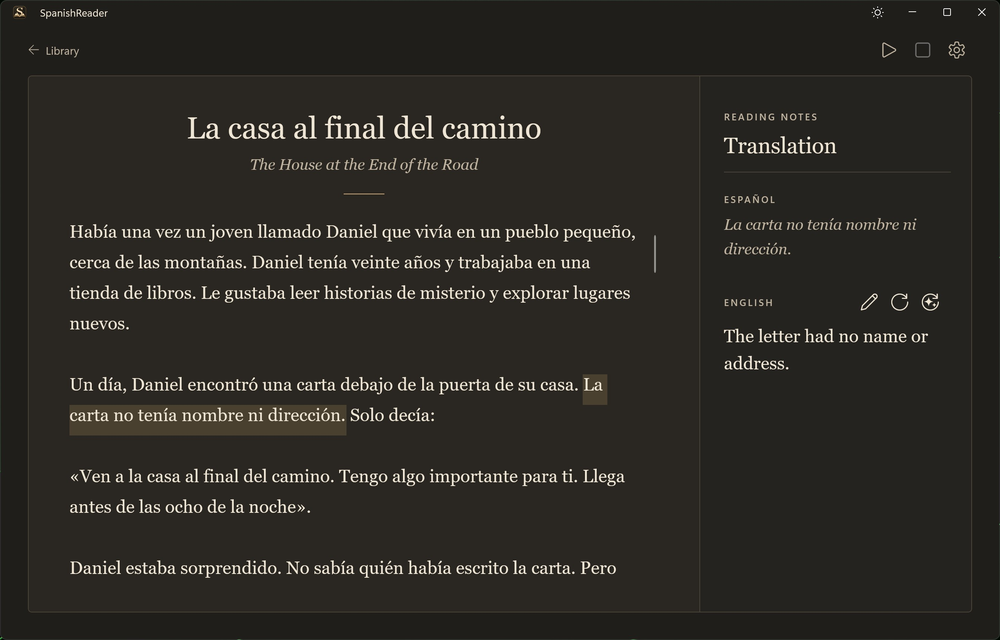

# SpanishReader

[](https://github.com/jm6271/SpanishReader/actions/workflows/ci.yml)

SpanishReader is a Windows app for reading Spanish stories with sentence-by-sentence English translations. Stories and translations are stored locally, and translation uses a bundled offline model.

## Using the app

1. In the library, select **Import**. Enter a Spanish title, CEFR level, and Spanish story text; an English title and author are optional. Select **Import story** to translate and save it.
2. Select a story in the library to read it. Select a sentence to see its English translation.
3. If a translation is missing or incorrect, select one of the retranslate buttons to enter a translation manually, translate using the default machine translation model, or translate in-context with an LLM.
4. Use the reader’s playback controls to listen with an installed Windows Spanish voice. To use Kokoro, select it under **Settings → Read aloud** and download its 326 MB model. Both engines work offline and offer voice and speed controls.
5. Use the library search, CEFR filter, and sort menu to find stories. A story's actions menu lets you edit or delete it.

## Installing the LLM

An LLM can optionally be installed for in-context translations. It can be downloaded from the settings page. The LLM can run on any available GPUs or on the CPU. Currently `Qwen3-1.7B-Q8_0` is used.

## Screenshot



## Bundled stories

See [Bundled stories](docs/bundled-stories.md) for authoring, translation, and first-run import details.

## Building from source

On Windows, install the .NET 11 SDK and the Windows development tools needed for WinUI 3. Open `SpanishReader.slnx` in Visual Studio, or build from a terminal:

```powershell
dotnet build SpanishReader\SpanishReader.csproj -p:Platform=x64
```

The application project is in `SpanishReader/`; application logic and its tests are in `SpanishReader.Core/` and `SpanishReader.Core.Tests/`. Run the core tests with:

```powershell
dotnet test SpanishReader.Core.Tests\SpanishReader.Core.Tests.csproj
```
