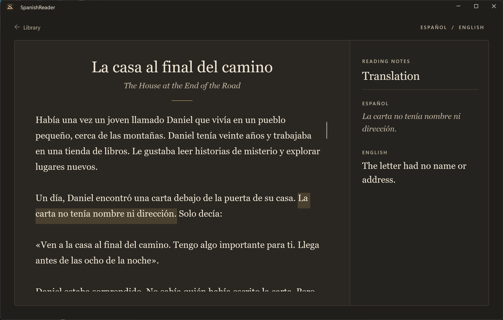

# SpanishReader

[](https://github.com/jm6271/SpanishReader/actions/workflows/ci.yml)

SpanishReader is a Windows app for reading Spanish stories with sentence-by-sentence English translations. Stories and translations are stored locally, and translation uses a bundled offline model.

## Using the app

1. In the library, select **Import**. Enter a Spanish title, CEFR level, and Spanish story text; an English title and author are optional. Select **Import story** to translate and save it.
2. Select a story in the library to read it. Select a sentence to see its English translation. If a translation is missing, use **Translate and save** to generate it.
3. Use the library search, CEFR filter, and sort menu to find stories. A story's actions menu lets you edit or delete it.

## Screenshot



## Building from source

On Windows, install the .NET 10 SDK and the Windows development tools needed for WinUI 3. Open `SpanishReader.slnx` in Visual Studio, or build from a terminal:

```powershell
dotnet build SpanishReader\SpanishReader.csproj -p:Platform=x64
```

The application project is in `SpanishReader/`; application logic and its tests are in `SpanishReader.Core/` and `SpanishReader.Core.Tests/`. Run the core tests with:

```powershell
dotnet test SpanishReader.Core.Tests\SpanishReader.Core.Tests.csproj
```
